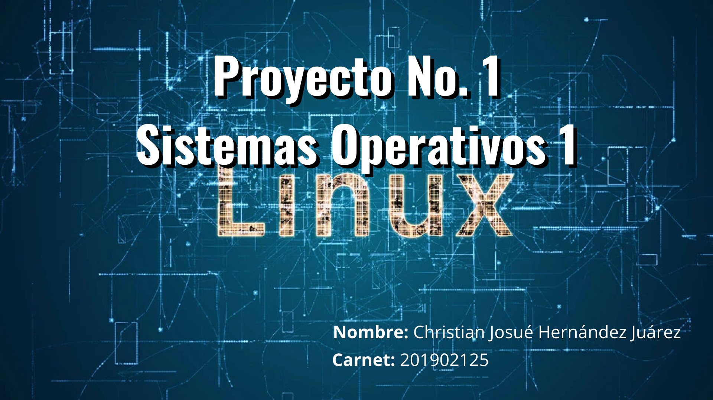

# Introducción

El proyecto No. 1 del curso Sistemas operativos 1 está enfocado en implementar un entorno de virtualización utilizando 3 máquinas virtuales, donde se ejecutan contenedores, las cuales tendrán APIs desarrolladas en go, las cuales tendrán un registro privado con Zot.

# Arquitectura del Sistema

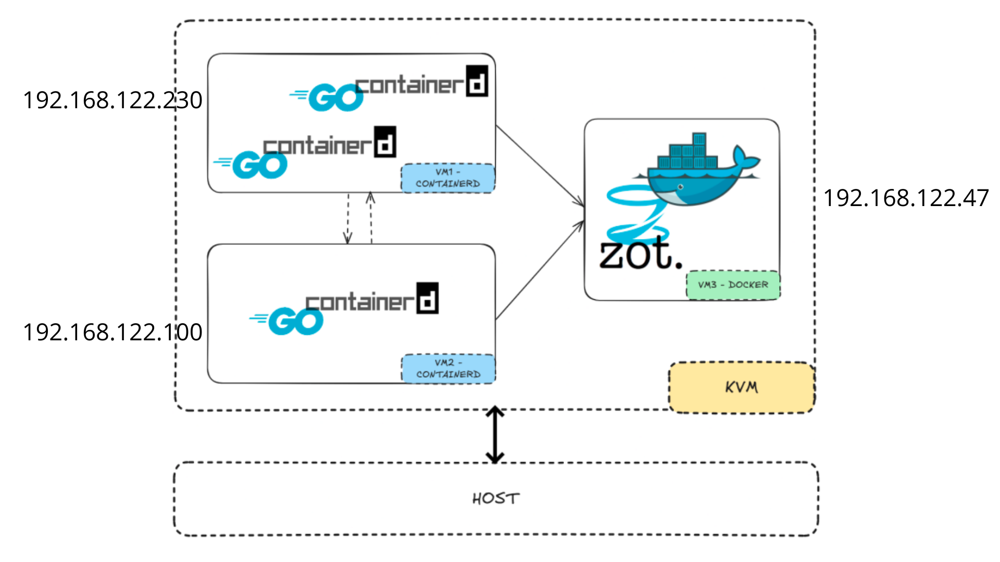


# Guía de instalación y configuración de las máquinas virtuales

## 1. Preparar nuestra computadora (host)

### Actualizar el sistema 

```bash
sudo apt update && sudo apt upgrade -y
```

### Instalar kvm y el gestor de máquinas virtuales

```bash
# Instalar KVM y el programa de gestor de máquinas virtuales
sudo apt install -y qemu-kvm libvirt-daemon-system libvirt-clients bridge-utils virt-manager
# Verificar que KVM esté funcionando
sudo kvm-ok
```

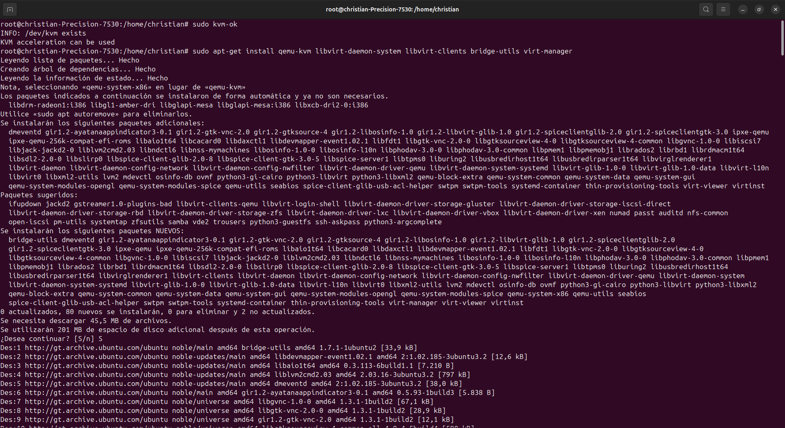
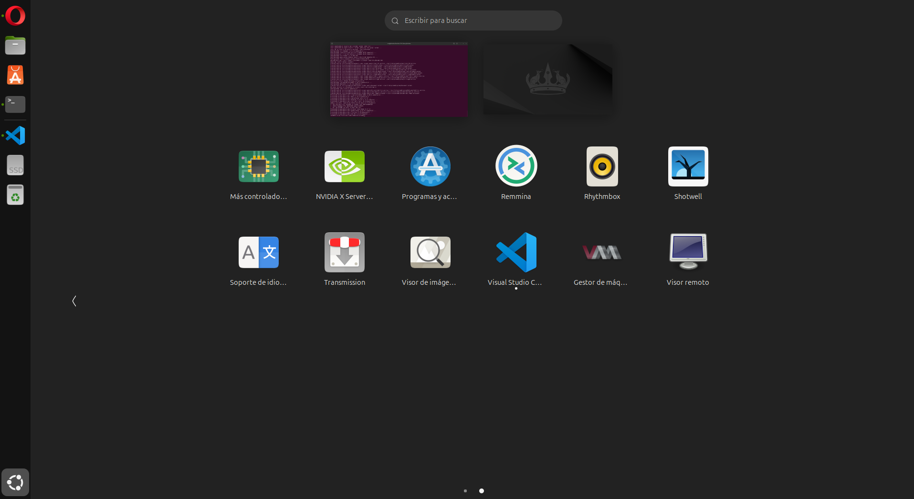

## 2. Creación de las máquinas virtuales (vm1, vm2, vm3)

### Primero tendremos que descargar la imagen de ubuntu que vamos a utilizar, en mi caso se utilizó Ubuntu Server 22.04.5 LTS 

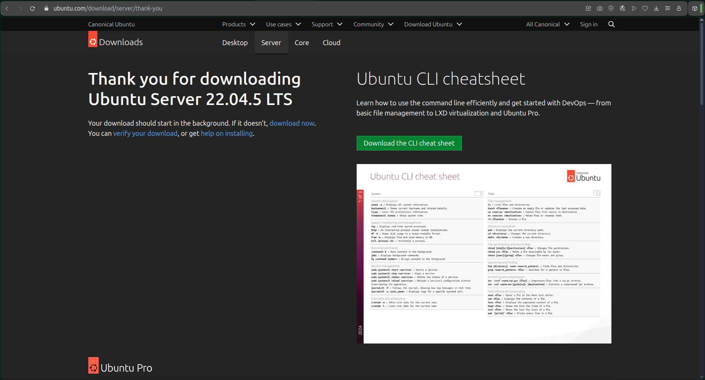

### Procedemos a cambiar de sitio la imagen iso a la carpeta de virtmanager

```bash
mv ubuntu-22.04.5-live-server-amd64.iso /var/lib/libvirt/images
```

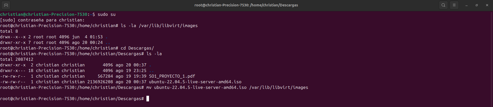

### Creamos las máquinas virtuales con el programa

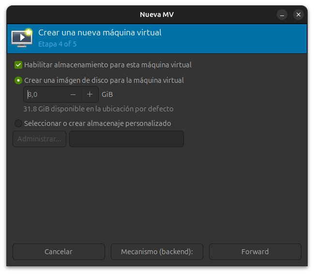

para cada máquina virtual utilicé estas especificaciones:


| vm |    nombre             | RAM   | CPUs   |   Espacio   |
|----|-----------------------|-------|--------|-------------|
| 1  | Ubuntu22.04-vm1       | 4 GB  | 2      |     8 GB    |
| 2  | Ubuntu22.04-vm2       | 4 GB  | 2      |     8 GB    |
| 3  | Ubuntu22.04-vm3       | 4 GB  | 2      |     15 GB   |


## 3. Paso adicional: Abrir las terminales de las máquinas virtuales desd

```bash
ssh usuario@IP_MV
```
por ejemplo: 

- Para mi maquina virtual 1:

```bash
ssh christian@192.168.122.230
```

- Para mi maquina virtual 2:

```bash
ssh christian@192.168.122.100
```

- Para mi maquina virtual 3:

```bash
ssh christian@192.168.122.47
```

## 4. Configuración de las máquinas virtuales 1 y 2 (vm1 y vm2)

### Instalación de conteinerd

```bash
# Instalar containerd
sudo apt update
sudo apt install -y containerd

# Configurar containerd
sudo mkdir -p /etc/containerd
containerd config default | sudo tee /etc/containerd/config.toml

# Reiniciar y habilitar containerd
sudo systemctl restart containerd
sudo systemctl enable containerd

sudo systemctl start containerd
sudo systemctl status containerd

sudo apt install -y runc
```

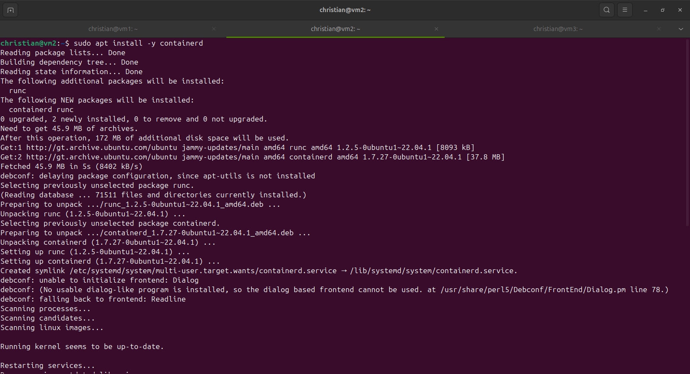

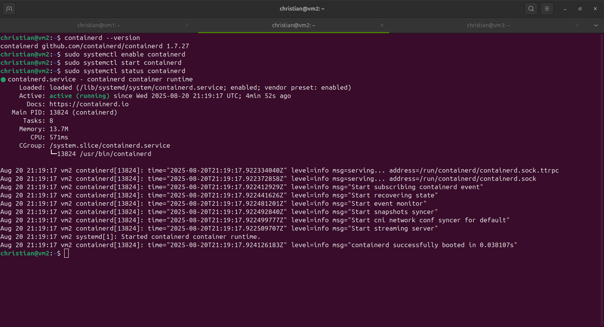

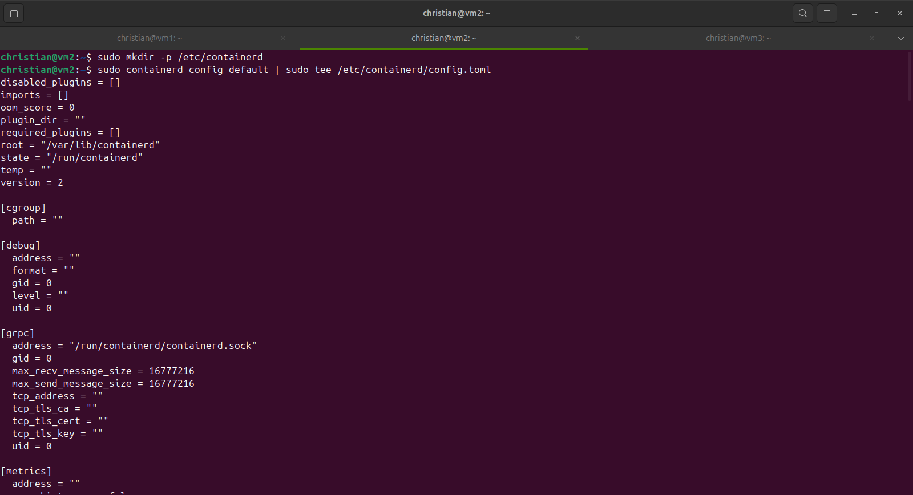


## 5. Configuración de máquina virtual 3 Zot y Docker (vm3)

```bash
# Instalar Docker
sudo apt install -y docker.io

sudo systemctl enable docker
sudo systemctl start docker

#Verficar si se intaló correctamente
docker --version

#Correr ZOT en docker

docker run -d \
  -p 5000:5000 \
  --name zot \
  ghcr.io/project-zot/zot-linux-amd64:latest

```

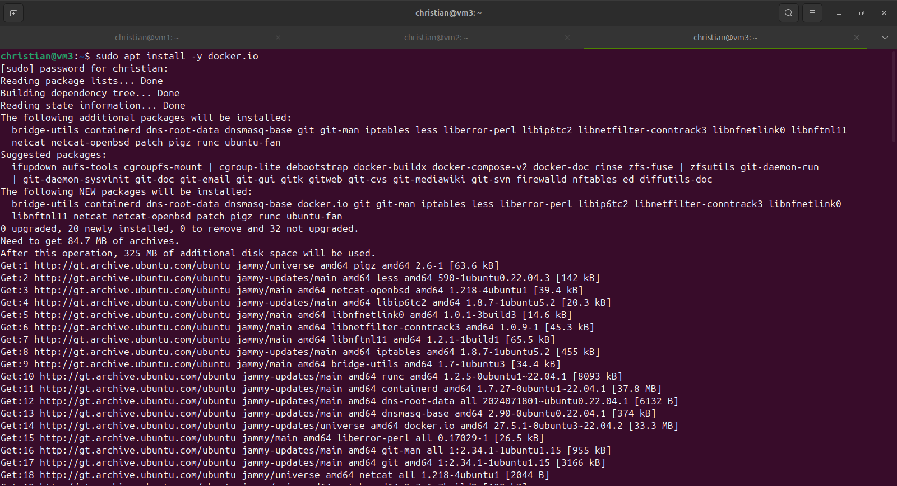

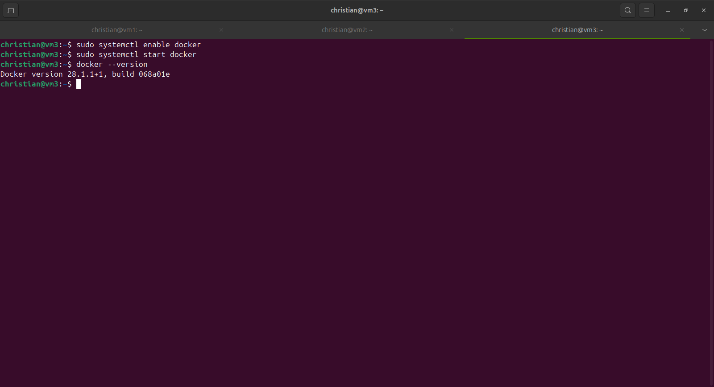

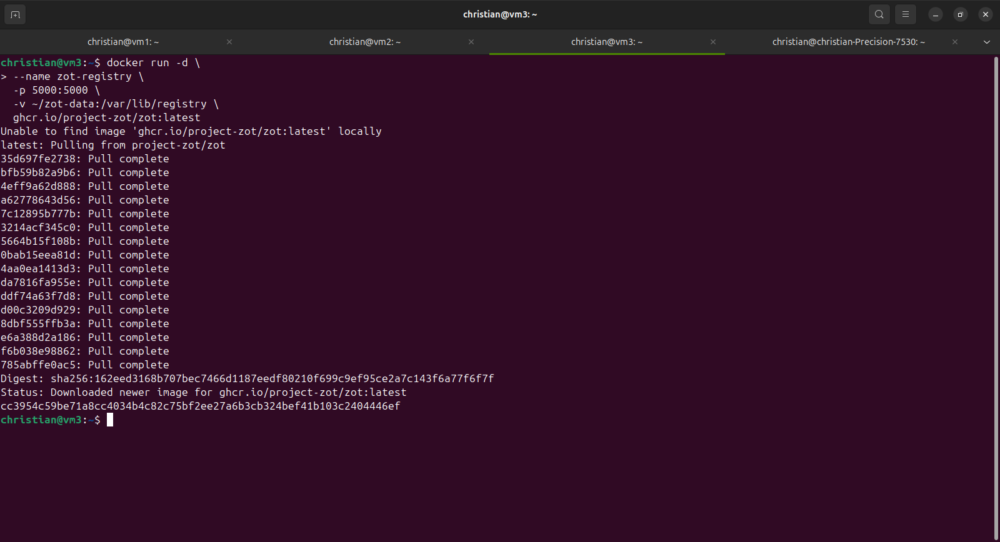

## 6. Crear APIs y dockerfiles desde el host

Cada carpeta contiene:

- api1
    - api1.go
    - Dockerfile
    - go.mod

Ejemplo del contenido de los archivos:

api1.go

```go
package main

import (
	"encoding/json"
	"fmt"
	"net/http"
)

type Response struct {
	Mensaje string `json:"mensaje"`
}

func main() {
	http.HandleFunc("/api1/201902125/llamar-api2", func(w http.ResponseWriter, r *http.Request) {
		Mensaje := Response{
			Mensaje: "Hola, responde la API: API2 en la VM1, desarrollada por el estudiante Christian Josué Hernández Juárez con carnet 201902125",
		}
		w.Header().Set("Content-Type", "application/json")
		json.NewEncoder(w).Encode(Mensaje)
	})

	http.HandleFunc("/api1/201902125/llamar-api3", func(w http.ResponseWriter, r *http.Request) {
		Mensaje := Response{
			Mensaje: "Hola, responde la API: API3 en la VM2, desarrollada por el estudiante Christian Josué Hernández Juárez con carnet 201902125",
		}
		w.Header().Set("Content-Type", "application/json")
		json.NewEncoder(w).Encode(Mensaje)
	})
	fmt.Println("API1 escuchando en el puerto 8080...")
	http.ListenAndServe(":8080", nil)
}
```

Dockerfile

```Dockerfile

FROM golang:latest AS builder

WORKDIR /app

COPY . .

RUN go mod tidy

RUN go build -o api1 .

FROM debian:bookworm-slim

WORKDIR /app

COPY --from=builder /app/api1 .

EXPOSE 8080

CMD ["./api1"]
```

## 7. Creación de las imagenes desde el host

Desde la carpeta de cada API ejecutar los comandos:

- Ejemplo para api1:

```bash
#Construccion de imagenes

docker build --no-cache -t api1-vm1:latest .

# tagear la imagen en la vm3

docker tag api1-vm1:latest 192.168.122.47:5000/api1-vm1:latest

# pushear la imagen

docker push 192.168.122.47:5000/api1-vm1:latest
```

En cada máquina virtual (vm1 y vm2):

vm1: 

```bash
#API 1
sudo ctr images pull --plain-http 192.168.122.47:5000/api1-vm1:latest

sudo ctr run -d   --net-host   192.168.122.47:5000/api1-vm1:latest   api1-container

#Api 2
sudo ctr images pull --plain-http 192.168.122.47:5000/api2-vm1:latest

sudo ctr run -d   --net-host   192.168.122.47:5000/api2-vm1:latest   api2-container

```

vm2: 

```bash
#API 3
sudo ctr images pull --plain-http 192.168.122.47:5000/api3-vm2:latest

sudo ctr run -d   --net-host   192.168.122.47:5000/api3-vm2:latest   api3-container

```

y para verificar en cada vm que están corriendo las tareas correspondientes 

```bash
sudo ctr task list
```

## 8. Ahora se procede a probar todas las APIs

API 1:

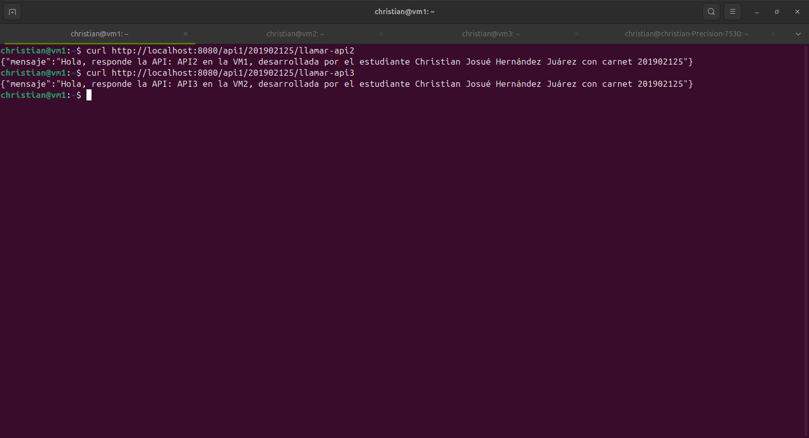

API 2:


API 3:

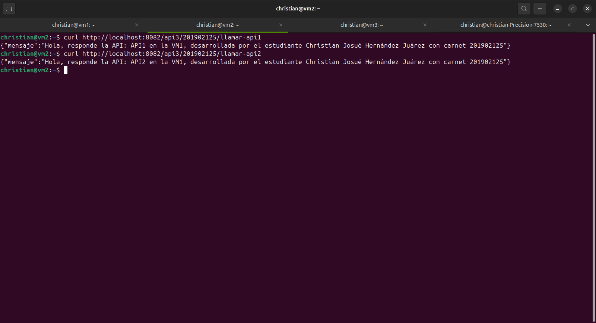