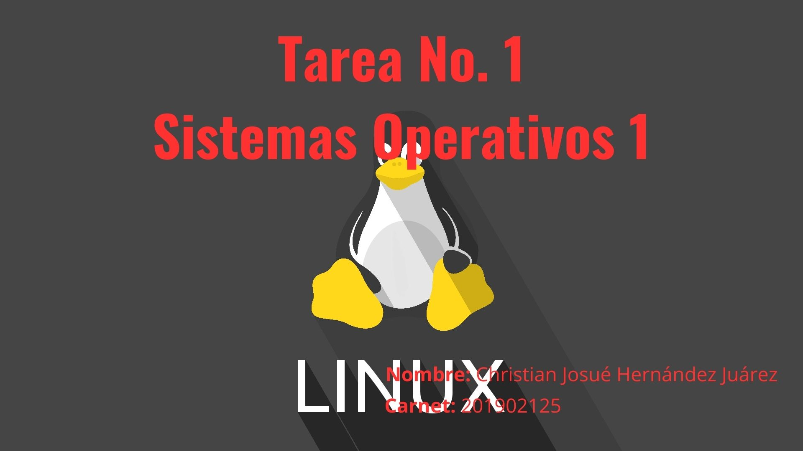

# Comandos

## Navegación de directorios

### ls:

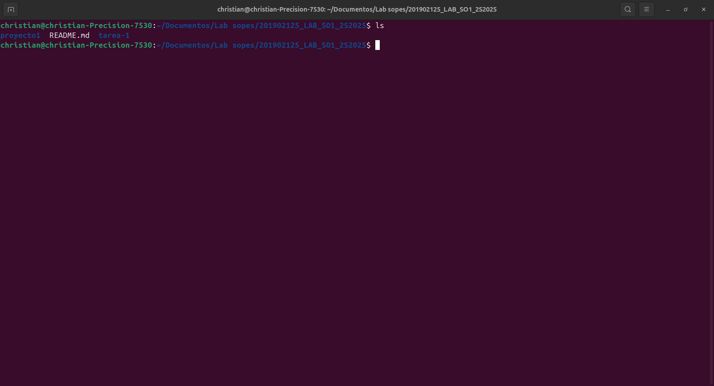

### cd:

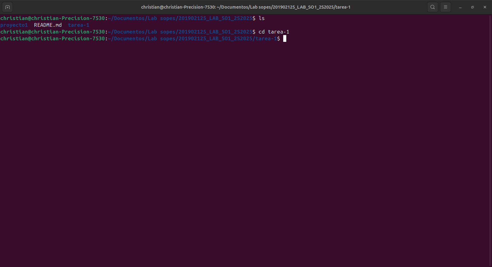

### pwd:

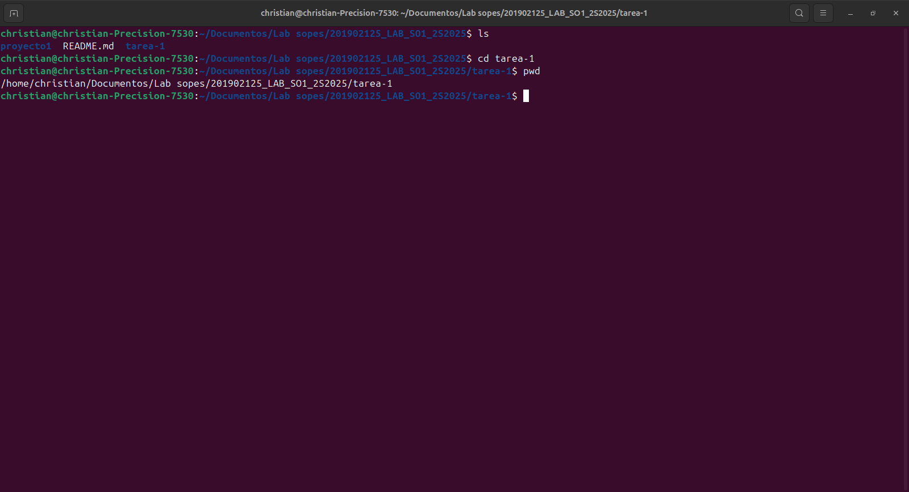

## Manipulación de archivos

### touch:

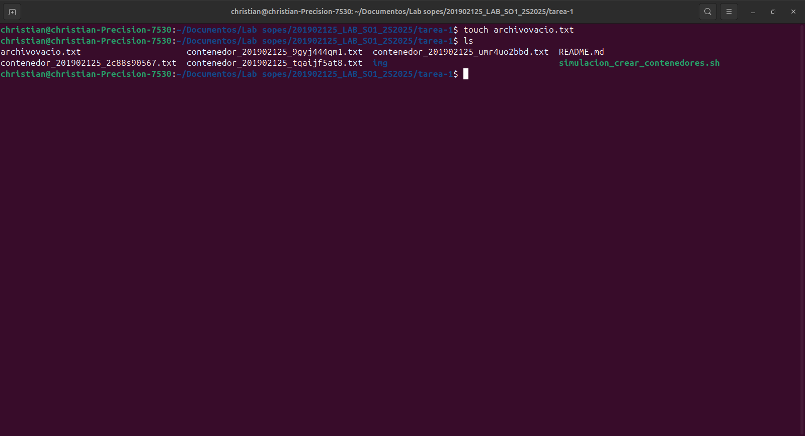

### cp:

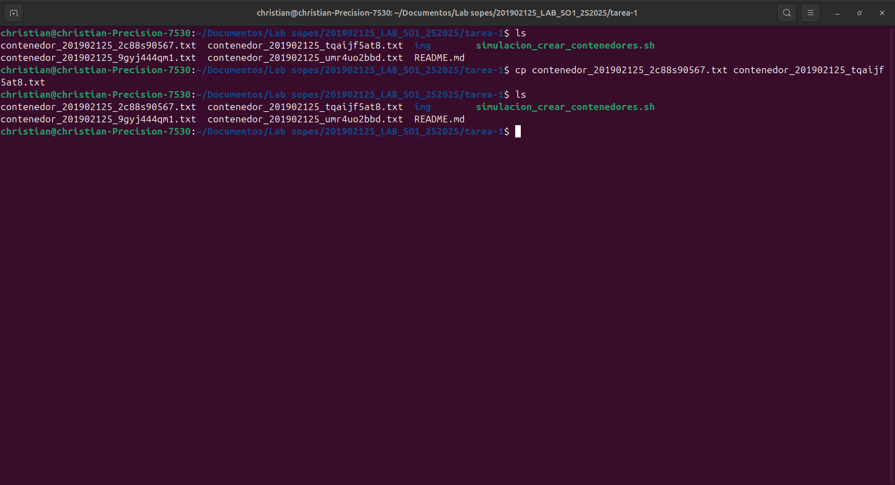

### mv:

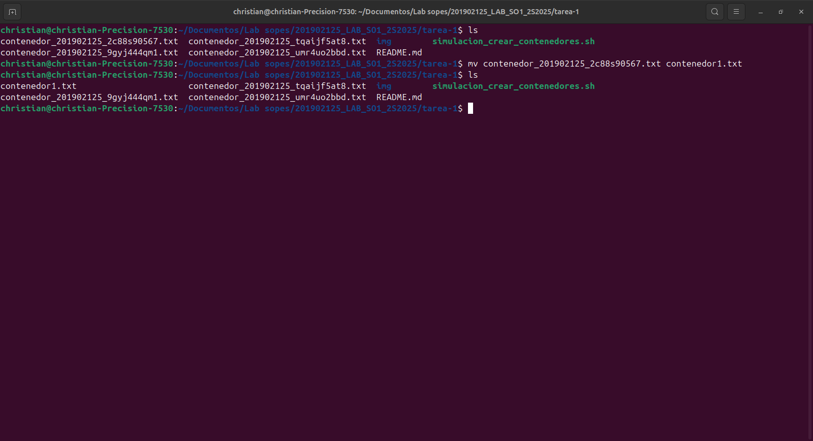

### rm:

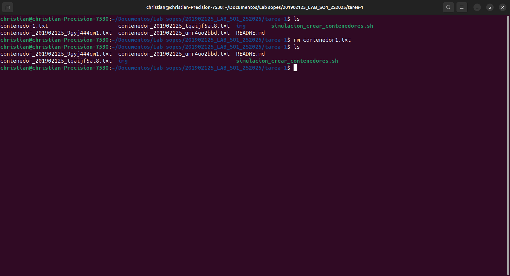

## Visualización de contenido

### cat:

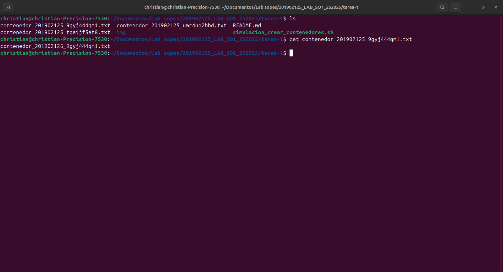

### more:

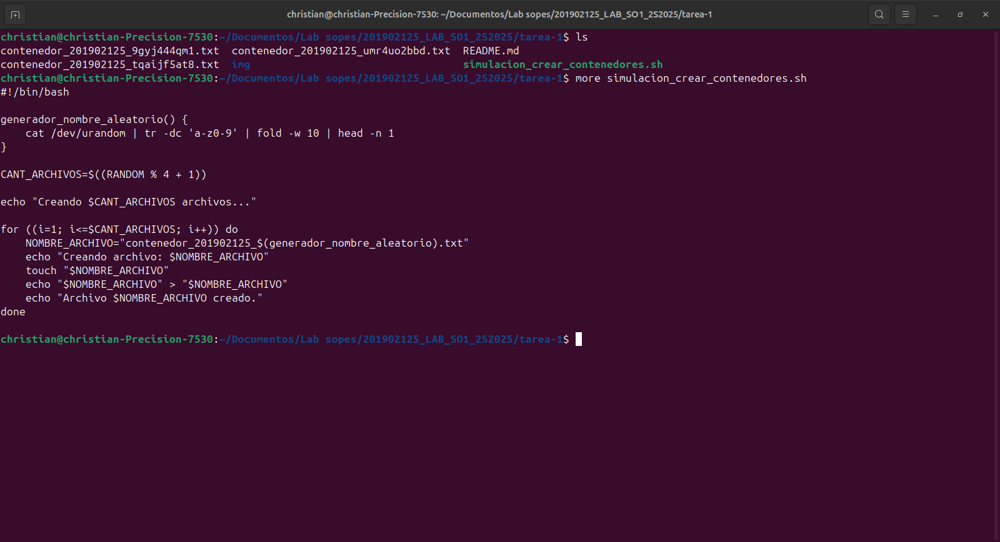

### less:

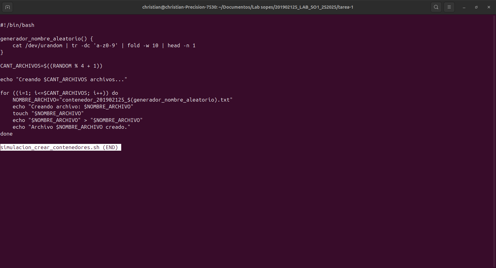

## Gestión de permisos

### chmod:

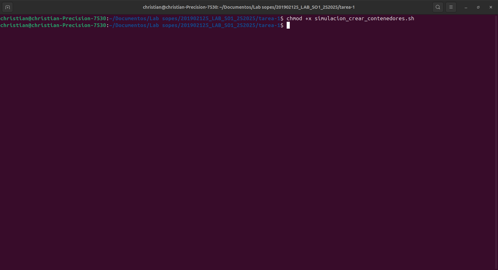

### chown:

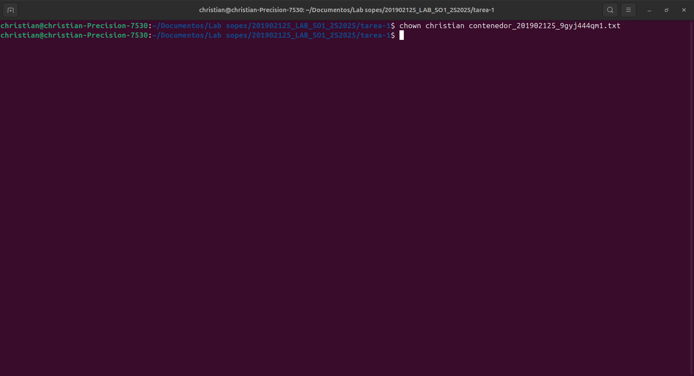

# Capturas de la ejecución

se ejecuta el archivo sh:

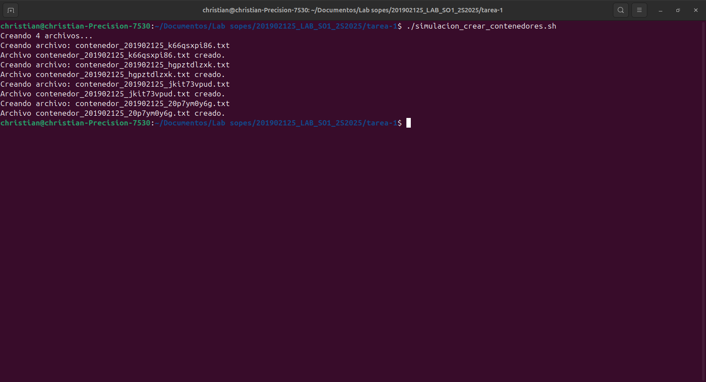

luego se verifica la creación de los archivos en el directorio:

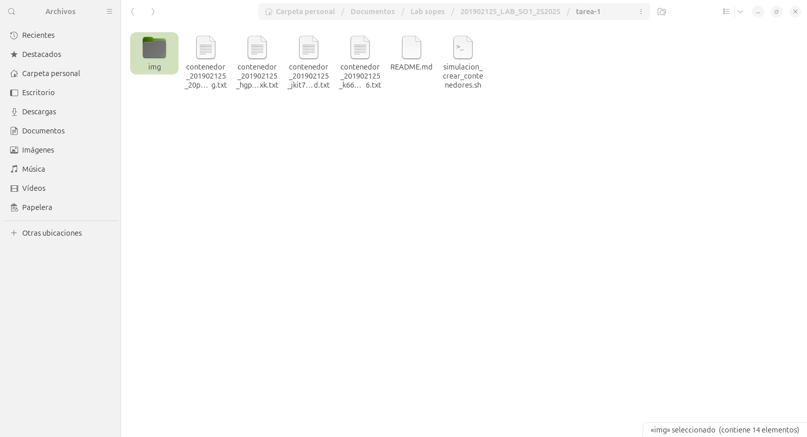

verificación del contenido de los archivos creados:

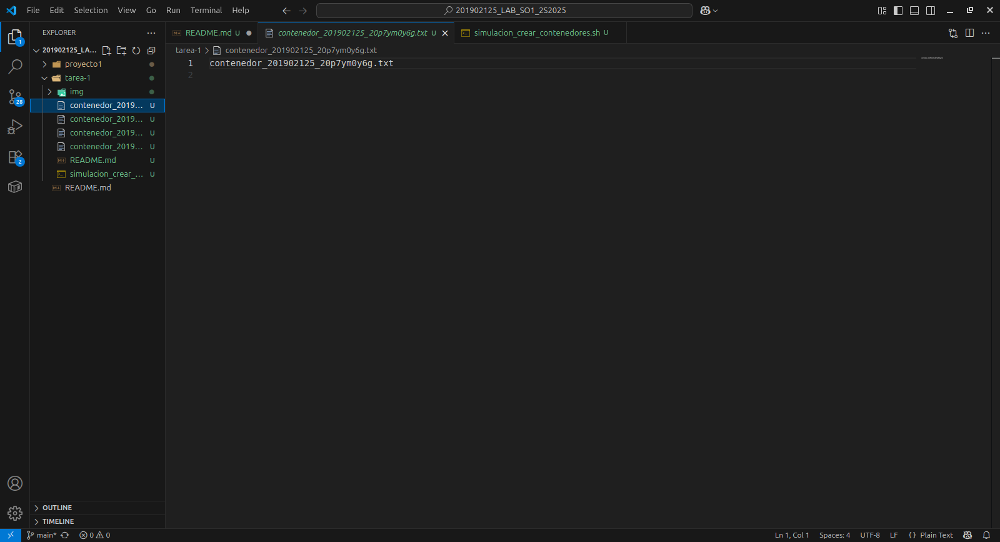